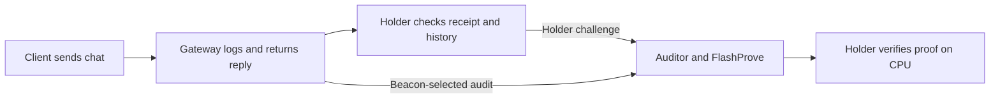

# Verified Inference Gateway

An OpenAI-compatible inference gateway that lets a client check whether a reply matches a specific model. It signs a receipt at delivery. For a challenged or sampled reply, [FlashProve][flashprove] supplies cryptographic evidence that the client can check offline on a CPU, without model weights.

[Try it locally](#try-it-on-a-cpu) · [Recorded proof run](docs/demo/README.md) · [Verify a reply](verifier/README.md) · [Specification](SPEC.md)

[](docs/demo/README.md)

One real request went through an opaque router to Llama 4 Maverick. The reply was `12<|eot|>`. A separate, disconnected CPU accepted the original proof and rejected a copy with one bit changed. [Commands, measurements and evidence](docs/demo/README.md)

## Try it on a CPU

With Git, Make and [uv 0.13.6][uv] installed, run from a clone of this repository.

```sh
make setup
make demo-router
```

Look for `"status": "passed"` and `"logged": 6`. The demo downloads and checks two pinned tokenizer files, serves synthetic replies with a mock engine, and verifies a real signed receipt log. Watch the holder recover a sealed receipt after the router strips it from the response. [Router demo and offline setup](router/README.md)

To build the standalone Linux verifier candidate and check its installed CLI against a signed fixture, run `make test-package`. To check a real proof, use the [native verifier instructions](verifier/README.md#verify-a-private-chat-reply-with-the-installed-native-checker).

## What the client can verify

| Evidence | What it checks |
| --- | --- |
| Signed receipt and log history | The exact reply is bound to the request and model commitment. With an inclusion proof and a trusted checkpoint, the holder can also check that the entry is in the log and that the history extends its checkpoint. |
| Conformance proof | Each returned token is the greedy choice of the committed integer model for the verified input. The holder kit separately checks input rendering, displayed text and reply completeness. |
| Deviation proof | A specific returned token differs from the committed model’s greedy choice. |

The gateway appends a log entry before delivering a warranted reply. In router mode, an opted-in holder can recover the receipt through sealed pickup. Proof work happens after delivery, when the holder challenges the receipt or public randomness selects it for audit.



The prototype targets one pinned integer conversion of **Llama 4 Maverick 17B-128E Instruct**, with greedy decoding and at most **1,024 tokens** across prompt and reply. The guarantee applies to audited replies and the committed function. Hardware identity, answer quality and data handling are outside its scope. [Model facts F3, F4 and F7](specs/facts-register.md#facts-register) · [Guarantee and trust assumptions](docs/spec/06-security.md#trust-and-evidence)

## Project status

Working prototype. The recorded run establishes one real proof-and-verification path through an operator-run router. The historical challenge and continuous all-audit soak are tracked separately for v1 qualification. The verifier is available as a source-built development wheel. [Release requirements](release/README.md) · [Changelog](CHANGELOG.md)

## Work on the project

- [Contribute](CONTRIBUTING.md) for setup, checks and how to open a focused PR.
- [Read the API](docs/spec/02-public-api.md), [architecture](docs/spec/01-architecture.md) or [accepted design decisions](docs/rfcs/README.md).
- [Report a security issue privately](SECURITY.md).

The gateway source is [Apache-2.0](LICENSE). The verifier bundle carries [third-party notices and model terms](distribution/verifier/README.md#attribution). Built with Llama.

[flashprove]: https://github.com/anthropics/FlashProve/tree/9e2bdd8ff5bf9c62f18263d7dac189b0400b260c
[uv]: https://docs.astral.sh/uv/getting-started/installation/
