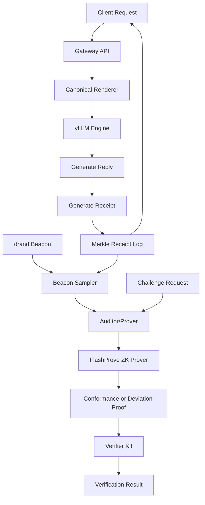

# Verified Inference Gateway

A zero-knowledge proof system for verifiable LLM inference serving using FlashProve.

## Local router demo

Run `make setup demo-router` to send synthetic chat requests through a local Mode R router. The holder recovers a sealed receipt after the router strips verification and checks the signed log. [Demo and proxy commands](router/README.md)

## The Problem

LLM inference providers make unverifiable claims. Users cannot confirm that a reply came from the advertised model. Providers could serve cheaper quantizations, different models, or modified outputs without detection.

## The Guarantee

Every reply carrying a receipt is bound into a public append-only log at delivery. A public rule over that log and a public randomness beacon, fixed after delivery, selects a fraction of replies for audit (configurable: 1/20, 1/1,000, or all). For each selected reply, and for any reply challenged within 30 days, the system produces either:

- **Conformance proof**: The reply's tokens are exactly the committed integer model's greedy choice at every position
- **Deviation proof**: The committed model chooses a different token at a stated position

Both proofs are checkable on a CPU in 21 to 44 seconds, without model weights, by anyone holding the transcript.

## How It Works



### Components

1. **Gateway API**: OpenAI-compatible HTTP endpoint accepting inference requests
2. **Canonical Renderer**: Deterministic prompt formatting ensuring bit-identical inputs
3. **vLLM Engine**: Inference engine with integrity gates enforcing greedy-only decoding
4. **Receipt Log**: Append-only Merkle tree binding each reply to its request and model configuration
5. **Beacon Sampler**: Uses drand quicknet public randomness to select replies for audit
6. **Auditor/Prover**: Generates ZK proofs via FlashProve for sampled or challenged replies
7. **Verifier Kit**: Standalone CPU-based verification without model weights

### Audit Process

After delivery, the beacon sampler computes a deterministic selection function over receipt commitments and the next drand round. Selected replies enter the audit queue. The prover regenerates each reply with instrumentation, then:

- **Conformance proof**: If outputs match, FlashProve produces a ZK proof of correct execution
- **Deviation proof**: If outputs differ, the system produces a proof identifying the first divergent token

Proofs are compact and verify in seconds on a CPU without access to model weights.

## What It Proves

**Proven (for audited replies):**
- Reply tokens are the committed integer model's greedy choice at every position
- Canonical rendering was applied to the request
- Receipt is cryptographically bound to the transcript
- Log is append-only and tamper-evident

**Not Proven:**
- **Integer model vs 16-bit model**: Top token differs at 6.81% of positions
- **Which machine served the reply**: Proves the function computed, not the hardware
- **Data handling**: No claims about retention, leakage, or training use
- **Unaudited replies**: Only statistical deterrence (sampling) and challenge availability
- **Model quality or training data**: No claims about model provenance

## Key Numbers

All values from FlashProve measurements and specification:

| Metric | Value | Source |
|--------|-------|--------|
| Verification time | 21 s (single thread), 36-44 s (shared VM) | FlashProve `guide/performance.md` |
| Proof generation | 58.8 s per request (1 per batch) | FlashProve `guide/performance.md` |
| Proving cost | 71.4 to 93.0× stock vLLM prefill GPU time | FlashProve `guide/performance.md` |
| Engine decode | 0.60 to 0.62 s per token | FlashProve `OPERATING.md` |
| Proof size | 18.78 MB average | FlashProve `guide/performance.md` |
| Window size | 1,024 tokens (prompt + reply) | FlashProve commitment |
| Sampling rates | 1/20 (live), 1/1,000 (shadow), 1 (soak) | Prototype configuration |
| Supported decoding | Greedy only (temperature=0) | FlashProve exact-match policy |

### Detection Probability

For sampling rate 1/N with n requests:

P(detection) = 1 - (1 - 1/N)^n

**At N=1,000:**
- Systematic deviation (every request): 95% detection in 3,000 requests
- 1% deviation over 1M requests: 99.995% detection

**At N=20 (prototype live):**
- Systematic deviation: 99.4% detection in 100 requests

See `specs/deterrence.md` for complete tables.

## Status

**Early Exploration - Nothing Built Yet**

This repository contains specifications and scaffolding only. No working implementation exists.

## Roadmap

- **M0 - Bring-up (2 weeks)**: Build FlashProve, download weights, prove 16 greedy replies, engine start-up gates pass
- **M1 - Gateway and log (2 weeks)**: GW, renderer, log, escrow, sampler, pickup, with mock engine and prover
- **M2 - Auditor (2 weeks)**: Challenge service, prover worker, reference scorer, verdict signer, audit API, verifier kit
- **M3 - Red team (1 week)**: Test suite covering R1-R19 attack vectors, 100% pass criterion
- **M4 - Router path and soak (1-2 weeks)**: Mode R feed, pickup, streaming, 72-hour soak at N=1

See `specs/build-plan.md` for detailed exit tests.

## Repository Layout

```
├── specs/              # Technical specifications (source of truth)
├── gateway/            # Gateway API server
├── engine/             # vLLM integration and integrity gates
├── log/                # Receipt log and Merkle tree
├── auditor/            # Beacon sampler and proof orchestration
├── prover/             # FlashProve integration
├── verifier/           # Standalone verification kit
├── redteam/            # Adversarial test suite
├── docs/               # Architecture decisions and integration guides
└── AGENTS.md           # Guidance for coding agents
```

## Documentation

- `AGENTS.md`: Guidance for coding agents working in this repo
- `CONTRIBUTING.md`: Contribution guidelines
- `specs/README.md`: Specification index and reading order
- `docs/decisions/`: Architecture decision records

## License

Apache License 2.0. See `LICENSE` for details.

## Technical Foundation

**FlashProve**: Open-source zero-knowledge proof system (Apache-2.0) at commit `9e2bdd8ff5bf9c62f18263d7dac189b0400b260c` (v0.16.0). Soundness bound: about q/2^124 + 2^-101 after q hash queries (random-oracle model, Lean-verified verifier).

**Model**: Llama 4 Maverick 17B-128E Instruct as FlashProve's integer model on `unsloth/Llama-4-Maverick-17B-128E-Instruct-GGUF` UD-Q4_K_XL files (third-party 4-bit conversion, 232 GB).

**Engine**: vLLM 0.29.0 with FlashProve's integer-model plug-in, greedy decoding only, one sequence at a time.

**Randomness**: drand quicknet (period 3s, chain hash `52db9ba7...e971`), public randomness beacon for unbiasable sample selection.

**Commitment**: Published ID `c7982f8a...1f46` (exact match, public seed), reproducible by anyone with weight files and calibration set.
