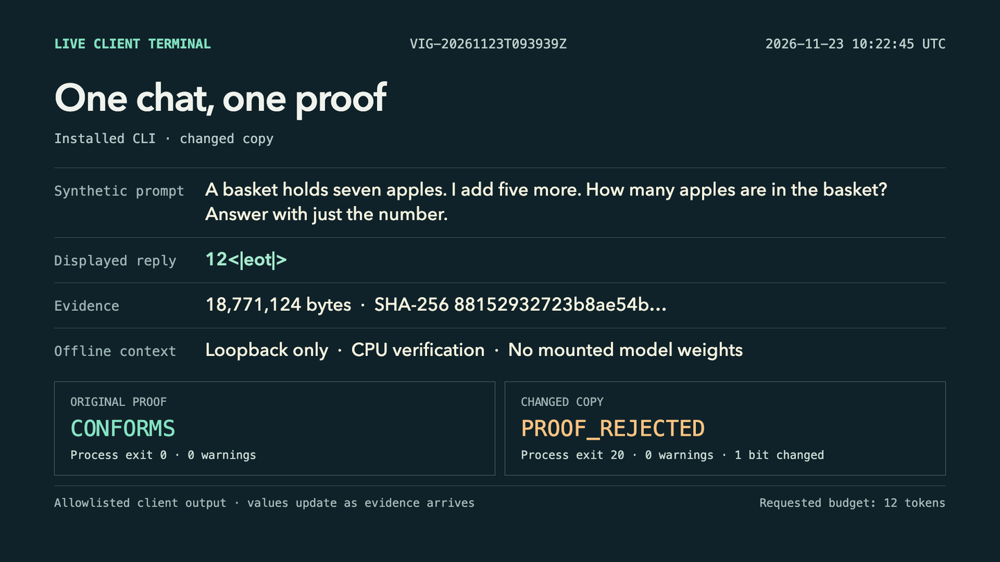
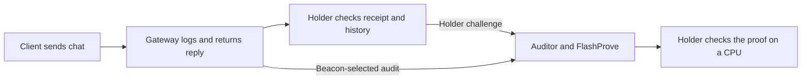

# Akashi

[](https://github.com/Lucid-Computing/akashi/actions/workflows/cpu.yml)
[](#status)
[](LICENSE)
[](pyproject.toml)
[][flashprove]
[](verifier/README.md)

**Verified inference. Every reply is signed and logged. Challenge one, and you get a proof of which model produced it that you check on a CPU, without the model weights.**

When you call a hosted model, you take the provider's word for which model answered. Akashi replaces that word with evidence. It is an OpenAI-compatible gateway in front of one committed integer build of Llama 4 Maverick. Before you see a reply, the gateway signs a receipt for it and appends it to a public log. Challenge the receipt, or let public randomness select it for audit, and the auditor returns a [FlashProve][flashprove] proof that each token was the committed model's greedy choice. Nobody has to trust the operator to check it.

[](docs/demo/README.md)

One real request went through an opaque router to Llama 4 Maverick and came back as `12<|eot|>`. A separate, disconnected CPU accepted the original proof and rejected a copy with one bit changed. [Commands, measurements and evidence](docs/demo/README.md)

## Why Akashi?

Akashi (証, ah-KAH-shee) means "proof" or "evidence" in Japanese, and 明かし means "revealing". That is what the gateway does: every answer comes with proof of which model produced it.

## Try it

You need Git, Make and [uv 0.13.6][uv]. No GPU, no model weights.

```sh
git clone https://github.com/Lucid-Computing/akashi.git
cd akashi
make setup
make demo-router
```

Look for `"status": "passed"` and `"logged": 6`. The demo checks two pinned tokenizer files, serves synthetic replies from a mock engine, writes a real signed receipt log and verifies it. Along the way a router strips the receipt from the response, and the holder recovers it through sealed pickup. [Router demo and offline setup](router/README.md)

Then build the standalone verifier and check the installed CLI against a signed fixture:

```sh
make test-package
```

To check a real proof, follow the [native verifier instructions](verifier/README.md#verify-a-private-chat-reply-with-the-installed-native-checker).

## How it works



1. **Serve.** The gateway renders the chat, the engine decodes greedily, and the log appends a signed entry. Only then is the reply delivered.
2. **Select.** A reply goes to audit when its holder challenges it, or when a public randomness beacon selects it. The receipt fixes a future beacon round before its randomness exists, so the operator cannot know which replies it will have to prove.
3. **Prove and check.** The auditor runs FlashProve on the selected reply. The holder verifies the proof offline, on a CPU, against the published model commitment.

Proving happens after delivery, so it costs the client no latency.

## What you can check

| Evidence | What it shows |
| --- | --- |
| Signed receipt and log history | The exact reply is bound to the request and the model commitment. With an inclusion proof and a trusted checkpoint, the entry is in the log and the history extends that checkpoint. |
| Conformance proof | Each returned token is the greedy choice of the committed integer model for the verified input. The holder kit separately checks input rendering, displayed text and reply completeness. |
| Deviation proof | A specific returned token differs from the committed model's greedy choice. |

## Scope

The guarantee is deliberately narrow, and it holds only for what it names.

- **One model.** A pinned integer conversion of Llama 4 Maverick 17B-128E Instruct.
- **Greedy decoding only.** Sampling parameters are rejected, because a sampled reply cannot be reproduced. [Why greedy only](docs/decisions/001-greedy-only-constraint.md)
- **At most 1,024 tokens** across prompt and reply.
- **Audited replies only.** A reply that is never challenged or selected is signed and logged, not proved.

It says nothing about hardware identity, answer quality or how your data is handled. [Model facts F3, F4 and F7](specs/facts-register.md#facts-register) · [Guarantee and trust assumptions](docs/spec/06-security.md#trust-and-evidence)

## Numbers

| | | Source |
| --- | --- | --- |
| Proof size | 18.78 MB average | [F25](specs/facts-register.md#facts-register) |
| Proof generation | 58.8 s per request, one per batch | [F23](specs/facts-register.md#facts-register) |
| CPU verification | about 21 s on one thread | [F26](specs/facts-register.md#facts-register) |
| Recorded run | 18,771,124-byte proof, accepted in 24.123 s on a separate CPU | [Demo](docs/demo/README.md) |

The first three are upstream FlashProve measurements. The last is one observation of the recorded deployment.

## Repository

| Path | What lives there |
| --- | --- |
| [`gateway/`](gateway/README.md) | OpenAI-compatible API, greedy policy, rendering and delivery |
| [`engine/`](engine/README.md) | Integer model engine and its startup integrity gates |
| [`log/`](log/README.md) | RFC 6962 Merkle log, signed tree heads and receipts |
| [`auditor/`](auditor/README.md) | Challenge intake, audit jobs and signed verdicts |
| [`prover/`](prover/README.md) | FlashProve proof requests and the proof worker |
| [`verifier/`](verifier/README.md) | Standalone holder verifier and the `akashi` CLI |
| [`router/`](router/README.md), [`pickup/`](pickup/README.md) | Opaque routing and sealed receipt pickup |
| [`redteam/`](redteam/README.md), [`soak/`](soak/README.md), [`release/`](release/README.md) | Attack regressions, the all-audit soak and release gates |
| [`specs/`](specs/README.md), [`docs/`](docs/spec/01-architecture.md) | Specification, facts register and design decisions |

## Status

Working prototype. The recorded run proves one real path end to end, from request through an operator-run router to offline verification. The historical challenge and the continuous all-audit soak are tracked separately for v1. The verifier ships as a source-built development wheel. [Release requirements](release/README.md) · [Changelog](CHANGELOG.md)

## Contributing

Start with [CONTRIBUTING.md](CONTRIBUTING.md) for setup, checks and how to open a focused pull request. The [API](docs/spec/02-public-api.md), [architecture](docs/spec/01-architecture.md) and [accepted design decisions](docs/rfcs/README.md) explain why things are the way they are. Report security issues privately through [SECURITY.md](SECURITY.md).

## Licence

The gateway source is [Apache-2.0](LICENSE). The verifier bundle carries [third-party notices and model terms](distribution/verifier/README.md#attribution). Built with Llama.

`Led by Lucid Computing`

[flashprove]: https://github.com/anthropics/FlashProve/tree/9e2bdd8ff5bf9c62f18263d7dac189b0400b260c
[uv]: https://docs.astral.sh/uv/getting-started/installation/
