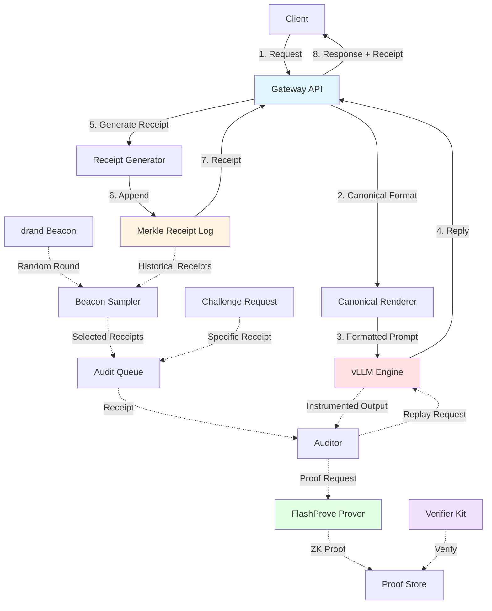

# System Architecture

## Overview

The verified inference gateway is a multi-component system that serves LLM inference while producing cryptographic proofs of correctness. The architecture separates serving (fast path) from auditing (slow path) to maintain acceptable latency for end users.

## High-Level Architecture



**Legend:**
- Solid lines: Fast path (request serving)
- Dashed lines: Slow path (auditing)

## Components

### 1. Gateway API

**Responsibility**: HTTP interface for client requests and responses.

**Functions:**
- Accept OpenAI-compatible API requests
- Validate request format and parameters
- Enforce greedy-only policy
- Generate and return receipts
- Handle challenge requests

**Interfaces:**
- **Input**: HTTP POST with JSON request body
- **Output**: JSON response with reply and receipt

**Technology**: Python (FastAPI or similar)

**Location**: `gateway/`

### 2. Canonical Renderer

**Responsibility**: Deterministic conversion of API requests to model inputs.

**Functions:**
- Apply chat templates deterministically
- Tokenize inputs with fixed tokenizer configuration
- Validate rendering consistency
- Produce reproducible prompt tensors

**Interfaces:**
- **Input**: Validated API request
- **Output**: Byte-identical prompt tensor

**Technology**: Python (transformers library)

**Location**: `gateway/renderer/`

**Critical Property**: Must be deterministic. Same request must produce identical output across all invocations.

### 3. vLLM Engine

**Responsibility**: LLM inference execution with integrity gates.

**Functions:**
- Run greedy decoding only
- Enforce temperature = 0.0
- Block sampling, top-k, top-p parameters
- Instrument outputs for proof generation
- Provide deterministic execution

**Interfaces:**
- **Input**: Canonical prompt tensor
- **Output**: Token sequence, logits (for audit)

**Technology**: vLLM (pinned version) with custom integrity wrapper

**Location**: `engine/`

**Integrity Gates:**
- Pre-execution: Validate parameters are greedy-only
- Post-execution: Log inference trace for potential audit

### 4. Receipt Generator

**Responsibility**: Create cryptographic commitments to requests and replies.

**Functions:**
- Hash request (canonical rendering)
- Hash reply tokens
- Combine with metadata (model ID, timestamp)
- Sign receipt commitment

**Interfaces:**
- **Input**: Request hash, reply hash, metadata
- **Output**: Cryptographic receipt

**Technology**: Python (cryptography library)

**Location**: `log/receipt.py`

**Receipt Format:**
```json
{
  "receipt_id": "unique-id",
  "timestamp": "2026-11-20T07:22:00Z",
  "request_hash": "sha256-of-canonical-request",
  "reply_hash": "sha256-of-reply-tokens",
  "model_id": "model-identifier",
  "model_hash": "sha256-of-weights",
  "signature": "cryptographic-signature",
  "merkle_proof": "path-to-root"
}
```

### 5. Merkle Receipt Log

**Responsibility**: Append-only tamper-evident log of all receipts.

**Functions:**
- Append new receipts atomically
- Maintain Merkle tree structure
- Provide inclusion proofs
- Prevent modification or deletion
- Publish root hashes

**Interfaces:**
- **Input**: New receipt
- **Output**: Merkle root, inclusion proof

**Technology**: Python or Rust (performance-critical)

**Location**: `log/merkle.py`

**Properties:**
- Append-only: No deletion or modification
- Tamper-evident: Root hash changes if any receipt changes
- Verifiable: Inclusion proofs verify membership

### 6. Beacon Sampler

**Responsibility**: Select receipts for audit using public randomness.

**Functions:**
- Fetch drand beacon rounds
- Compute deterministic selection function
- Select approximately 1/1000 receipts
- Queue selected receipts for audit
- Publish selection proofs

**Interfaces:**
- **Input**: Merkle log, drand beacon round
- **Output**: Selected receipt IDs

**Technology**: Python with drand client library

**Location**: `auditor/sampler.py`

**Sampling Formula:**
```
selected = hash(receipt_id || beacon_round) mod 1000 == 0
```

### 7. Auditor

**Responsibility**: Orchestrate proof generation for sampled or challenged receipts.

**Functions:**
- Fetch receipts from queue
- Replay original request through engine with instrumentation
- Compare outputs
- Request conformance or deviation proof
- Publish proofs

**Interfaces:**
- **Input**: Receipt to audit
- **Output**: Conformance proof or deviation proof

**Technology**: Python orchestration

**Location**: `auditor/orchestrator.py`

### 8. FlashProve Prover

**Responsibility**: Generate zero-knowledge proofs of inference correctness.

**Functions:**
- Instrument vLLM execution
- Capture execution trace
- Generate ZK proof via FlashProve
- Produce conformance proofs
- Produce deviation proofs

**Interfaces:**
- **Input**: Instrumented inference trace
- **Output**: ZK proof artifact

**Technology**: FlashProve (Rust, pinned commit), vLLM integration

**Location**: `prover/`

**Proof Generation:**
- Conformance: Prove output matches expected
- Deviation: Prove first divergent token and expected value

### 9. Verifier Kit

**Responsibility**: Standalone proof verification without model weights.

**Functions:**
- Verify conformance proofs
- Verify deviation proofs
- Check Merkle inclusion proofs
- Validate signatures
- Run on commodity CPUs

**Interfaces:**
- **Input**: Proof, receipt, public parameters
- **Output**: Valid/Invalid

**Technology**: Rust (standalone binary)

**Location**: `verifier/`

**Deployment**: Distributed as standalone binary, no dependencies on inference infrastructure

## Data Flow

### Fast Path (Request Serving)

1. Client sends request to Gateway API
2. Gateway validates request format and parameters
3. Canonical Renderer produces deterministic prompt
4. vLLM Engine generates reply (greedy decoding)
5. Receipt Generator creates cryptographic receipt
6. Merkle Log appends receipt atomically
7. Gateway returns reply and receipt to client

**Latency Target**: < 2x native vLLM inference time

### Slow Path (Auditing)

1. Beacon Sampler selects receipts using drand randomness (or challenge is submitted)
2. Auditor fetches receipt from Merkle Log
3. Auditor replays request through instrumented engine
4. Auditor compares outputs:
   - If match: Request conformance proof from FlashProve
   - If mismatch: Request deviation proof from FlashProve
5. Prover generates ZK proof
6. Proof published to Proof Store
7. Verifier Kit can verify proof independently

**Latency Target**: Seconds to minutes (not user-facing)

## Component Boundaries

### Trust Boundaries

- **Client-Gateway**: Untrusted network, requires receipts for verification
- **Gateway-Engine**: Trusted (same operator), integrity gates enforce correctness
- **Engine-Prover**: Trusted (same operator), instrumentation required
- **Prover-Verifier**: Untrusted (anyone can verify), proofs must be sound

### Performance Boundaries

- **Fast Path**: User-facing, low latency required
- **Slow Path**: Asynchronous, higher latency acceptable
- **Proof Generation**: Expensive, rate-limited

### Security Boundaries

- **Receipt Generation**: Cryptographic, tamper-evident
- **Merkle Log**: Append-only, public auditability
- **Proof System**: Zero-knowledge, verifiable without trust

## Deployment Model

### Single-Node Deployment

For initial development:
- All components on one machine
- Shared vLLM engine between serving and auditing
- Local Merkle log storage
- Proof generation queued locally

### Distributed Deployment

For production:
- Gateway: Load-balanced HTTP servers
- Engine: Dedicated GPU inference cluster
- Merkle Log: Distributed consensus (e.g., etcd, raft)
- Auditor: Separate audit cluster
- Prover: GPU cluster for proof generation
- Verifier: Anywhere (no special hardware)

## Configuration and Versioning

### Pinned Versions

All components MUST use exact pinned versions:

```yaml
model:
  id: "llama-4-maverick"
  weights_hash: "sha256:abcd1234..."
  
engine:
  vllm_version: "0.6.3"
  
prover:
  flashprove_commit: "a1b2c3d4"
  
beacon:
  drand_chain: "quicknet"
  drand_endpoint: "https://api.drand.sh"
```

### Environment Variables

Critical configuration via environment:
- Model paths
- Beacon endpoints
- Log storage locations
- Proof storage locations
- No secrets in version control

## Scalability Considerations

### Throughput Limits

- **Serving**: Limited by vLLM throughput
- **Auditing**: Limited by proof generation capacity
- **Sampling Rate**: 1/1000 implies 1 proof per 1000 requests

### Cost Model

Per request:
- **Serving**: Standard inference cost (0.60 to 0.62 s per token, F22)
- **Receipt**: Negligible (hash + append)

Per audit (1/1000 requests):
- **Proof Generation**: 71.4 to 93.0× stock vLLM prefill GPU time (F23)
- **Verification**: About 21 s single thread, 36.2 to 44.0 s shared VM (F26)

### Bottlenecks

1. **Proof Generation**: Most expensive operation
2. **Merkle Log Writes**: Requires consensus in distributed setup
3. **Beacon Sampling**: Requires drand availability

## Failure Modes

### Gateway Failure

**Impact**: Serving unavailable, no new receipts

**Mitigation**: Load balancer, multiple gateway instances

### Engine Failure

**Impact**: Inference unavailable

**Mitigation**: Engine redundancy, health checks

### Merkle Log Failure

**Impact**: Cannot append receipts, serving blocked

**Mitigation**: Consensus protocol, backups

### Beacon Unavailable

**Impact**: Cannot select new audits, existing audits continue

**Mitigation**: Cache recent beacon rounds, retry logic

### Proof Generation Failure

**Impact**: Specific audit fails, does not affect serving

**Mitigation**: Retry with exponential backoff, manual review

## Observability

### Metrics

- Requests per second
- Inference latency (p50, p99)
- Receipt generation latency
- Merkle log append latency
- Audit queue depth
- Proof generation success rate
- Proof generation latency
- Verification success rate

### Logs

- Request logs (hashed for privacy)
- Receipt logs (full receipts)
- Audit logs (selection, replay, proof generation)
- Error logs (failures, retries)

### Alerts

- Gateway unavailable
- Engine failures
- Merkle log failures
- Audit queue backlog
- Proof generation failures
- Beacon unavailable

## Security Hardening

See `observability.md` and `redteam-suite.md` for detailed security considerations.

## Related Specifications

- `guarantee.md`: Security properties this architecture provides
- `gateway-api.md`: Gateway interface details
- `engine.md`: Engine integration and integrity gates
- `receipt-log.md`: Merkle log implementation
- `audit-protocol.md`: Proof generation details
- `capacity.md`: Scalability and performance analysis
